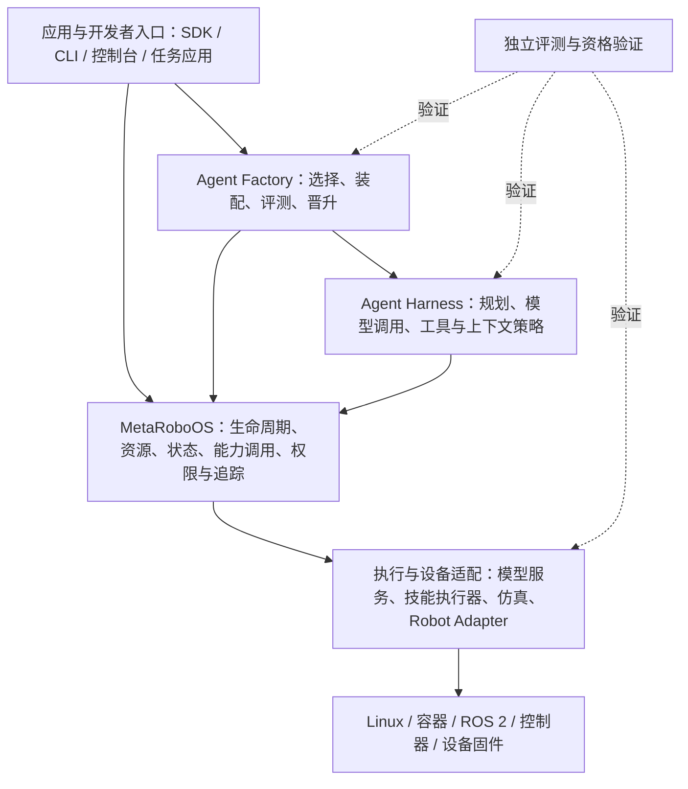

# MetaRoboOS：具身 OS 与智能体生产框架

更新日期：2026-11-06。文档状态：架构草案与阶段实现记录，作为后续设计与验收依据。

本文保留“完整易用、模块化、跨任务、跨本体、软硬件协调、可持续进化”的目标，区分当前实现与目标设计。除“当前 baseline 与已验证能力”明确列出的内容外，下述 OS 服务、系统契约与 Factory 能力均为待实现设计，不代表已完成。

## 1. 项目定位与目标

MetaRoboOS 是运行在 Linux 等宿主系统之上的具身系统服务层，为机器人、模型、技能和 Agent 提供统一的执行、资源、状态、能力调用与权限机制。在此之上构建 Agent Factory，面向不同任务、本体和资源条件生产可执行、可验证、可交付的 Agent Harness。

### 1.1 三个层次

1. **具身系统底座**：管理工作负载、设备、资源、通信、时间、权限、追踪和部署。
2. **智能体生产与进化层**：选择组件、装配 Harness、生成候选、执行评测、晋升与回退版本。
3. **应用与开发者生态**：提供 SDK、CLI、控制台、组件目录和任务应用，支持第三方开发与交付。

目标闭环为：

```text
任务 + 本体 + 资源预算 + 运行策略
                 ↓
       组件选择、能力匹配与 Harness 装配
                 ↓
       可执行计划 + 内容锁 + 部署物
                 ↓
          资格验证、任务评测与晋升
                 ↓
          部署运行、监控与后续迭代
```

### 1.2 架构原则

- 小核心、模块化、可扩展；逻辑模块、发行包与运行进程不要求一一对应。
- 机制与策略分离；OS 不绑定某个模型、机器人或 Agent Harness。
- 统一身份、执行语义和错误边界，允许不同能力具有不同的业务接口。
- 复用 Linux、容器、ROS 2、设备驱动和控制器，不重复实现成熟基础设施。
- Factory 通过公开系统 API 工作，不绕过资源、权限、设备执行和验证机制。
- 所有动作空间、单位、坐标系和本体转换必须显式声明，不能由通用核心隐式猜测。
- 可追溯不等于确定性；版本锁、轨迹记录与实际复现结果分别报告。

### 1.3 首版范围与后续范围

首版以单机、有限组件库、明确资源与一组设备能力为范围，先证明模块装配、常驻运行、控制权管理和失败处理成立。跨本体验证先通过异构仿真或设备适配完成，再扩展真实设备。

多节点通用调度、任意组件热替换、自动编写生产插件、跨本体零适配迁移和开放式自进化属于后续能力。保留这些目标，但不能以接口占位、目录拆分或单次 smoke 测试宣称完成。

## 2. 当前 baseline 与已验证能力

### 2.1 SenseNova-RoboRSI 模块化底座

现有 M5 已建立独立发行、插件发现、声明式装配、执行后端、原评测接入和可迁移部署边界。基线发行包为 `roborsi-sdk`、`roborsi`、`roborsi-libero`、`roborsi-agent-27b`、`roborsi-icl`，另有独立示例组件包。

| 能力 | 当前已有 | 不能据此推导的能力 |
| --- | --- | --- |
| SDK 与组件契约 | 生命周期、能力描述、配置、动作/观测及 Episode 语义 | 已覆盖所有真实设备和跨本体语义 |
| 发现与装配 | entry point、依赖绑定、兼容性检查、装配内容锁 | 自动设计 Harness 或自动生成插件 |
| 执行与资源 | local / Docker / HTTP、资源准入、租约、超时、取消与清理 | 常驻 OS、分布式一致性或本地配额的强制隔离 |
| 评测与追踪 | 原 batch / case 工作流、原生评分、结果和执行轨迹 | 长期运行系统的完整状态管理 |
| 交付与重建 | wheel 依赖闭包、文件资产/镜像身份、部署导出与冷安装 | 任意平台迁移或自动设备资格认证 |

当前本地资源池属于协作工作负载之间的准入管理，不能将其等同于操作系统强制限额。相关声明见 [资源租约实现](../SenseNova-RoboRSI/roborsi/execution/leases.py)。

具体发行与验证范围见 [M5 指南](../SenseNova-RoboRSI/docs/modularity-m5.zh-CN.md) 和 [M5 验收汇总](../SenseNova-RoboRSI/work/modularity/m5/acceptance-summary.json)。真实 27B 全量基准、第二本体和真实设备生产资格不属于 M5 已完成结论。

### 2.2 modularize-demo

独立示例位于 [modularize-demo](modularize-demo/README.md)，通过新增 `roborsi-manual-counter` 包注册 `model.manual_counter`，绑定到已有 Agent，复用原 Environment、Context 和评测链路。

- 只替换 Model：两个计数任务由原模型共 9 步变为新模型共 5 步，两者聚合分数均为 1.0。
- SDK-only 环境中 7 项测试通过；插件不依赖 core 的 BaseProvider。
- 部署搬迁、删除临时输入项目、新环境离线安装和运行通过。
- 配置错误、版本不兼容、锁漂移、内容篡改、插件移除与恢复均有检查记录。
- 当前 Environment、Agent、Context 仍共用原示例发行包；没有按每个业务角色独立发行。

这些结果验证外部插件装配与交付，不代表真实模型推理、物理控制、不同本体适配或实时性验证。原生评分文件中的 `physical_steps` 在此处只是计数环境的动作步数。证据见 [最近一次 demo 验收](modularize-demo/evidence/latest.json)。

### 2.3 P0：独立系统入口与 Mock 能力执行闭环

新增 `metaos-contracts`、`metaos-runtime` 与 `metaos-mock-arm` 三个独立发行包，复用 SDK 生命周期与能力契约。系统使用新的 `SystemSpec`，不要求 Agent、Environment、Episode、benchmark 或评分器才能启动；现有评测式 `AssemblySpec` 保持原有边界。

- 通用组件 DAG 支持显式端口绑定、能力/版本/配置校验、拓扑打开、逆序关闭与内容锁；设备和 monitor 两节点用于验证依赖图。
- 本机 HTTP 网关提供资源发现、状态、有限期控制租约、代次、异步命令、反馈、取消和结果查询；调用方由 Bearer 凭据与 ACL 确定。
- 能力调用检查单位、坐标系、截止时间、状态序号与新鲜度；控制权释放、到期、调用方退出和服务正常关闭均要求在途动作停止确认。
- 相同命令身份去重；提交响应丢失后查询原 ID，不自动重发新命令；停止未确认时资源进入故障状态并拒绝后续控制。
- 离线部署冻结依赖闭包、清单、哈希、来源和平台；搬迁并删除本次临时输入项目后，在新环境安装和执行。

运行方法、验收结果与范围见 [README](README.md)、[P0 交付报告](docs/p0-delivery.md)、[接口说明](docs/p0-api.md) 和 [最近一次完整验收](evidence/p0-latest.json)。

以上是 P0 `serve` 入口的历史范围：进程内协作设备插件、package/config-only 部署，不支持 workspace resume。P1/P2 新增的常驻路径见下节；两种入口保留各自明确的运行边界。

### 2.4 P1/P2：异构仿真与独立执行基础设施

截至 2026-11-06，contracts/runtime 为 0.2.0，独立的 `metaos-joint-degrees`、`metaos-libero-device` 为 0.1.0，`metaos-libero-harness` 为 0.1.1。实现与证据见 [P1/P2 交付记录](docs/p1p2-delivery.md)，命令见 [操作说明](docs/p1p2-api.md)。2026-11-05 已通过外部 API 模型 `deepseek-ai/DeepSeek-V4.1-Flash` 完成真实 LIBERO-Pro 单任务闭环：`libero_spatial_task-t00-i00`、seed 0，原生 success / score=1.0，303 个物理步，资源清理确认通过。证据见 [API 单任务索引](evidence/libero-api-latest.json)。指定原 27B 模型的验收仍受远程显存不足阻塞，不将 API 模型结果等同于原 27B 或全基准验收。

- `manage` 提供公共 Manager；每个实例由独立 Worker 打开 SystemSpec 图并持有 Gateway 最终授权。OS 环境仍不依赖原评测器和模型库，Harness 是另行安装的客户端应用。
- 持久目录记录实例的期望/实际状态、资源身份、内容锁、进程 PID/启动代次与故障；支持创建、启动、停止、明确确认后的重启与对账。任务 API 管理能力动作命令，尚不是 Agent 作业调度器。
- Worker 独立接收管理器心跳；失联后停止准入、撤销租约并停止在途命令。管理器恢复时校验锁并接管原 Worker；旧管理器、时钟域与租约被隔离，未知动作保留原身份且不自动重放。
- 显式 degrees Adapter 转换动作、状态与反馈；LIBERO 保留原生 7D OSC/世界坐标语义、原任务预算和评分协议，不经过 Mock 关节空间转换。错误维度、单位、坐标系、旧会话和旧状态在动作执行前拒绝。
- 原生相机、评分、轨迹与 MP4 通过有权限检查的 artifact API 传输，并校验大小、会话身份和 SHA-256。Harness 无需原生服务写接口或 Worker 私有文件挂载。
- 部署支持项目根内声明的文件输入、不可变原生镜像身份及离线镜像归档；新环境从搬迁后的部署物重建。原 Agent/真实 ICL/tokenizer 有独立应用部署与 reset 验证。Harness 0.1.1 支持普通符号链接 venv，记录 Agent 实际解释器身份；启动失败也落盘未评分结果与 trace，单个 Adapter 仅服务一个会话。

当前故障矩阵覆盖管理器 SIGKILL、Worker 退出/阻塞、调用方退出、响应丢失、多调用方争用、权限、旧代次与时序错误。原 Agent 另有实际 CLI 的模型连接失败、Agent 进程退出、模型超时验证，检查未评分结果、取消、释放与接管。原生确定性动作测试与原 Agent reset 分别是基础设施证据和输入加载证据，均不是 27B 推理证据；具体通过项以交付记录和原始报告为准。

该实现仍是单机原型：没有恶意插件沙箱、硬实时或真实硬件停止保证，没有 GPU 资源池/跨节点调度、长期生产 SLO 或 Factory。原生容器提供声明的 CPU/内存/GPU 可见性限制；资源目录本身不等于宿主机所有算力的强制调度。

### 2.5 RoboCasa365：第二种原生环境的插件与装配接入

2026-11-06 新增独立 `metaos-robocasa-device==0.1.0` 与 `metaos-robocasa-harness==0.1.0`。通过 SDK entry point、SystemSpec 和现有本地资源池装配，未增加通用 runtime 环境分支；OS/Harness 使用分别安装的离线包闭包。

保留原 Target50 task+seed 身份、原 ICL Agent/提示词与 split 预算。策略 stop 后可评分，操作 cancel 不评分；感知作为原生工具动作，不声称支持独立 BenchmarkQuery。9 项设备测试、16 项 Harness 测试、340 个 ICL cell 绑定、共享 HTTP 协议 fixture 和 plan/build/verify 已通过。**未运行真实 RoboCasa 仿真或模型推理**；镜像、GPU/RLDX 与真实任务仍待验收，不据此宣称异构环境真实端到端资格已完成。见 [接入说明](docs/robocasa-integration.md) 和 [证据](evidence/robocasa-latest.json)。

## 3. 总体架构与职责边界

“统一安装 → 声明式构建 → 具身实验运行”的具体增量设计见 [Harness 架构](docs/harness-architecture.md)。该文定义包目录、HarnessSpec、Builder、Experiment Runner 与现有 SystemSpec/执行网关的衔接，属于待实现设计。

2026-11-05 已增加 [本地资源装配 v1](docs/local-composition.md)，先使用已有路径、已安装环境和本地服务完成 build/run。它复用当前执行底座，尚不包含远程包拉取、自动依赖安装或任意业务组件图编译。

2026-11-06 已同步最新真实实验与工作区目录，清理旧版本、重复构建和旧实验；保留最新成功实验、其运行依赖及当前资格验收证据。实际位置与引用边界见 [目录与工作区说明](docs/workspace-layout.md)。



### 3.1 系统 Runtime 与 Agent Runtime

| 部分 | 负责 | 不负责 |
| --- | --- | --- |
| 系统执行 Runtime | 进程/容器生命周期、资源、通信、取消、监控和清理 | 规划算法、提示词、记忆策略和工具选择 |
| Agent Runtime / Harness | 推理循环、上下文组织、工具与技能编排、任务策略 | 绕过执行网关直接控制设备或修改权限 |
| Agent Factory | 选择组件、生成装配方案、评测候选、管理晋升 | 直接修改正在控制设备的执行实例 |
| 评测与资格验证 | 任务表现、接口兼容、故障行为、预算与部署条件检查 | 替代设备执行器的停止与安全机制 |

既有 Agent 推理实现可继续作为 Harness 包复用。OS 服务不应以 benchmark、case 或评分器存在为启动前提。现有评测代码可先保持发行兼容，通过接口逐步解除系统服务与评测应用的耦合。

### 3.2 控制面与数据面

- **控制面**：安装、发现、装配、授权、租约、任务提交、配置更新和版本晋升。
- **数据面**：传感器数据、状态反馈、模型输入输出和控制指令。
- 控制面负责建立访问和执行条件，不要求相机帧、点云或控制循环全部经过中心服务。
- 规划、推理、轨迹执行和底层控制分别声明周期、截止时间与失败策略，不放入一个无边界的通用执行循环。
- 底层控制优先复用控制器和驱动；ROS 2 Actions、生命周期与 ros2_control 可作为适配参照 [R1][R2][R3]。

## 4. 核心功能需求

以下十项是系统能力域，首版可由少量服务实现，不要求拆成十个独立微服务。

### 4.1 Process Space — 工作负载进程空间

- 管理 Agent、Skill、模型服务、设备适配器和后台系统服务的隔离运行环境。
- 支持创建、配置、启动、停用、终止、健康检查和受控重启，区分常驻服务与单次任务。
- 分别记录期望状态与实际状态；管理器重启后先重新确认实例、任务与设备状态，再决定恢复行为。
- 进程暂停/恢复与物理任务暂停/恢复分开。仅声明支持并具备恢复契约的任务允许恢复。
- 权限、环境、资源配额和日志边界显式声明；后端不支持的隔离能力必须报告，不得默认为已生效。

### 4.2 VFS — 具身虚拟资源命名空间

- 首版提供资源命名与访问协议，不预设必须实现 POSIX 文件系统或 FUSE。
- 统一定位机器人、模型、技能、传感器、环境、任务和运行实例，例如 `robots/arm-01`、`sensors/camera-01`、`tasks/task-123`。
- 资源提供身份、描述、能力、状态和权限；文件、命令、异步任务与数据流采用各自合适的访问语义。
- 支持挂载、卸载、发现和动态注册；资源消失应产生可观察事件。
- 活动资源替换必须检查调用方、依赖、在途任务与设备状态，不承诺任意资源无条件热替换。

### 4.3 System API — 统一具身系统接口

- 提供资源发现、状态订阅、能力调用、动作任务提交、反馈、取消和结果查询。
- 统一请求身份、权限、截止条件、错误和结果语义，允许能力采用不同业务接口。
- 能力示例：`navigation.navigate_to/v1`、`manipulation.move_joint/v1`、`manipulation.move_pose/v1`、`gripper.command/v1`。
- 明确动作单位、坐标系、关节顺序、限制、频率与停止行为；转换由显式 Adapter/Translator 完成。
- 长时动作以任务句柄管理；通信适配可映射到 ROS 2 Actions 等机制，但系统语义由自身契约定义 [R1]。

### 4.4 Resource Manager — 异构资源与控制权管理

- 发现和分配 CPU、GPU、内存、显存相关能力及设备资源，区分资源准入与后端强制隔离。
- GPU 编号分配不等于显存限额；后端应报告实际可实施的隔离能力。
- 支持资源配额、优先级、等待、超时、释放和可观察的分配记录。
- 物理设备区分观察权限与控制权限，默认避免多个写入者竞争同一执行能力。
- 控制租约带有效期与控制权代次；撤销或换主后，最终执行网关拒绝旧代次命令。
- 控制权交接先撤销旧权限、处理在途动作并确认设备声明的交接状态，再允许新的写入者执行，不能只更新租约记录。
- 代次由明确的控制权权威分配，管理器或网关重启后仍须能够拒绝旧代次；无法确认时先完成对账，不重新开放写入。
- 后续扩展 Worker 注册、心跳和多节点调度；网络分区下的设备控制规则必须先定义，再实现调度策略。

### 4.5 Package Manager — 组件包与不可变交付

- 支持 Model、Skill、Tool、Perception、Robot Adapter、Environment Adapter、Harness 和应用包。
- 支持注册、检索、安装、卸载、更新、依赖解析、兼容检查与内容锁。
- 包身份覆盖代码、配置 Schema、模型/数据资产、运行镜像和外部前提；凭据只声明引用，不进入包。
- 使用不可变版本与内容身份；更新产生新部署物，旧运行记录保留原版本锁。
- 区分已安装、已验证与允许部署的版本。软件回滚需检查当前设备和任务状态，不代表撤销物理动作。
- 首版复用 wheel、OCI 等成熟交付格式，优先完善元数据和资格记录，不先开发新的通用包格式。

### 4.6 IPC & Message Bus — 进程间通信

- 支持 RPC、Pub/Sub、异步任务和连续数据流，明确每类接口的顺序、丢弃、背压与超时策略。
- 本地与跨节点传输通过适配器接入，允许 ROS 2、HTTP、gRPC 等实现，不要求首版全部支持。
- 大体积媒体与高频数据可使用独立数据通道；引用需关联资源身份、时间信息与生命周期。
- 对有副作用的调用定义请求去重、重试条件和结果查询，不假设通信层能够保证物理动作恰好执行一次。

### 4.7 State & Time Management — 状态、时间与坐标

- 分别管理设备、环境、任务和工作负载状态，保留状态来源、版本、有效性和观察时间。
- 区分系统时间、单调时间和仿真时间，支持时间域身份与仿真时钟跳变处理 [R4]。
- 状态/观测记录采样时间、接收时间、序号、坐标系与标定版本；缺失或过期状态应显式标识。
- 多传感器关联声明同步容差和时钟映射；不同节点的单调时间值不能直接比较。
- 状态快照用于诊断与受约束恢复，不能假定恢复软件快照能够恢复真实物理世界。
- 坐标与状态服务通过适配层复用已有实现；跨本体转换显式记录来源与适用条件。

### 4.8 Security & Safety — 权限与执行约束

- Security 管理身份、组件/设备/API 权限与凭据；Safety 管理动作边界、状态约束和停止策略。
- Agent 使用最小必要的能力权限，通过最终执行网关控制设备；部署权限设计需阻止绕过网关的直接写入。
- 执行侧校验身份、控制权代次、命令有效性、状态新鲜度和动作限制。
- Watchdog、停止与恢复授权不依赖上层 Agent 正常工作；底层控制与 Agent 推理解耦 [R3]。
- Agent 崩溃、取消、租约到期或通信中断后，按设备声明的停止/保持策略处理，并验证反馈。
- 紧急停止触发后，恢复需重新确认状态与授权，不允许自动重试旧动作。
- 软件隔离、动作约束和实际设备资格分别验证，不以容器化或静态接口检查代替设备运行验证。

### 4.9 Observability & Trace — 监控、轨迹与审计

- 提供日志、指标、健康事件与跨进程追踪，关联任务、请求、资源、租约和部署身份。
- 记录 Observation、Action、Feedback、执行结果及其时间域与来源。
- 区分离线轨迹回放、仿真重放和真实设备重新执行，后者必须重新授权与验证状态。
- 保留失败、未知结果、取消请求和实际停止证据，不能只记录最终成功/失败标签。
- 定义数据保留、敏感信息过滤、存储配额和媒体清理策略，避免无限累积。
- 使用固定任务、输入、版本与条件进行比较；非确定性执行报告差异，不承诺逐字节复现。

### 4.10 Component Registry & Lifecycle — 目录与生命周期

- **Package Catalog**：描述可获取与可安装的包、版本、兼容性和资格状态。
- **Runtime Registry**：描述运行实例、所在节点、健康状态、期望状态和实际状态。
- **Resource/Capability Directory**：描述当前可访问的设备资源、能力、状态和控制权。
- 三者可共用服务，但身份与状态模型分开，不能把“包已安装”等同于“设备能力可用”。
- 统一描述、配置、准备、激活、停用和释放，保留现有 `describe / plan / prepare / open` SDK 的兼容边界。
- 激活与停用需声明业务效果，不能把组件 inactive 等同于设备已安全停止；生命周期可参考 ROS 2 managed nodes [R2]。
- 替换活动组件前处理在途任务、依赖、设备状态和重新资格验证，再切换引用并保留回退路径。

## 5. 核心契约与物理执行语义

本节类型名表示目标层概念。优先扩展或适配现有 SDK，不能据此认定新 Schema 已实现，也不要求直接重命名现有类型。

### 5.1 必要描述与产物

| 契约/产物 | 最小职责 |
| --- | --- |
| ComponentDescriptor | 类型、版本、能力、依赖端口、配置、资源与运行前提 |
| EmbodimentSpec | 设备身份、动作空间、单位、坐标系、关节/控制器、约束、固件与标定身份 |
| TaskSpec | 目标、必要能力、成功/停止判定、输入与评测条件 |
| ModelSpec | 服务协议、模型/权重身份、输入输出、资源与外部服务前提 |
| PolicySpec | 权限、允许能力、控制边界、停止/恢复与部署策略 |
| AssemblySpec | 组件、显式转换、依赖绑定与逻辑入口；沿用现有装配边界 |
| RunSpec / DeploymentPlan | 执行后端、节点、资源、任务选择、超时与产物位置 |
| ContentLock / DeploymentArtifact | 固定代码、配置、资产、依赖和运行条件，支持校验与重建 |
| QualificationReport | 验证范围、实际命令与结果、失败证据、条件、预算和未覆盖项 |

资格结果绑定到具体版本与运行条件。某个模型/机器人组合通过，不代表同名组件的任意版本或任意本体都通过。

### 5.2 命令与任务

物理命令至少关联：请求/任务身份、目标资源与能力、调用方、控制权代次、有效性条件、参数、状态依据和追踪身份。

```text
submitted → accepted → executing → succeeded / failed / cancelled
     └────→ rejected

executing → cancel_requested → 执行侧确认后的终态
```

- `accepted` 表示执行方受理，不表示设备已执行；`cancel_requested` 不等同于已停止。
- 最终结果需包含执行方反馈和状态依据。被撤销的旧控制者不得继续提交有效命令。
- 超时或断连导致结果无法确认时，记录 `outcome_unknown` 与待对账状态；不能伪造终态后自动重试。
- 重试前查询执行记录及设备状态。只能对声明可去重/幂等的能力，按契约复用请求身份。
- 不具备恢复契约的动作在故障后停止并重新规划；不能默认从进程或模型会话断点继续物理执行。

### 5.3 时间有效性与停止

- 命令必须说明时间域和有效性判断方法；跨节点需有明确时钟映射或接收端新鲜度策略。
- 过期动作、过期观测、无效标定和撤销代次在执行入口被拒绝或进入声明的降级策略。
- 停止预算、反馈条件和降级状态由设备/控制器契约明确；不能为所有本体指定一个未经验证的统一停止时限。
- 软件取消、控制器停止和硬件紧急停止分别记录；恢复前检查设备实际状态。

## 6. 从 baseline 复用与抽取的模块

模块化仍以依赖独立、插件扩展、契约可检查、装配可追溯、行为可兼容为要求。新增环境或技能不应要求修改通用核心的名称列表与本体分支。保留现有任务协议、原生评分和结果格式的兼容边界。

| 目标逻辑模块 | 职责 | 当前可复用来源与演进方式 |
| --- | --- | --- |
| contracts | 公共数据、能力、错误、生命周期与业务接口 | `roborsi/contracts/`；增加设备、时间与执行语义 |
| components | 组件目录、版本、配置与发现 | `roborsi/components/`；扩展运行实例与能力目录 |
| composition | 依赖解析、语义校验、计划与内容锁 | 当前实现为 `roborsi/assembly/`，无需为名称一致先重构目录 |
| system runtime / platform | 工作负载、后端、资源、取消、清理与部署 | `roborsi/execution/`、`roborsi/deployment/`；补充常驻协调与设备控制权 |
| agent runtime / harness | 推理、上下文、工具、技能与会话策略 | 复用现有 Agent/planner/runtime，作为上层可替换实现 |
| device / transport adapters | 设备、控制器、仿真、通信和显式转换 | 从已验证 Adapter 边界扩展，不把硬件细节写入通用核心 |
| evaluation | 任务、资格验证、评分、比较与恢复 | 复用 `roborsi/evaluation/`；作为系统 API 的独立调用方 |
| application | 准备、装配、运行、评测和交付用例 | 复用现有 CLI/工作流，保持 CLI 为薄入口 |
| factory | 约束驱动选择、候选装配、评测和版本晋升 | 新建上层能力，调用前述公开接口 |

不要求立即拆出更多发行包或服务。先用依赖检查、独立安装、替换实验与故障场景证明边界，再按交付和运行需求调整打包粒度。

## 7. Agent Factory 与受约束进化

### 7.1 首版输入与输出

输入：`TaskSpec + EmbodimentSpec + 资源预算 + PolicySpec + 可用组件目录`。

输出：`AssemblySpec + 部署方案 + ContentLock + QualificationReport`。

流程：能力需求解析 → 候选选择 → 显式适配 → 装配校验 → 预算检查 → 隔离验证 → 任务评测 → 版本晋升。

首版在受控组件库中选择和装配。缺失能力、预算不足或契约冲突时给出可解释的失败，不隐式调用未声明服务，不静默替换动作空间。

### 7.2 进化与晋升

```text
生成候选 → 隔离构建与测试 → 固定评测集与故障验证
        → 审核/策略门禁 → 可部署版本 → 运行监控
```

- 候选版本、已验证版本与已授权部署版本分开。
- Factory 不修改正在控制设备的包字节、运行锁和权限；新候选生成独立产物。
- 评测环境与评分规则独立于被优化 Agent，保留固定评测集与保留集，防止只优化当前测试。
- 晋升同时考虑任务表现、时延、资源、故障行为和证据完整性，不只依据单次成功率。
- 回退软件版本前检查物理状态和兼容性；异常物理状态先处理，不能将部署回退当作动作撤销。
- 自动生成插件代码属于后续扩展，使用相同的构建、验证和晋升规则，不绕过门禁。

## 8. 分阶段交付与验收

以下是 MetaRoboOS 的阶段路线，不能与已经完成的 M5 混为一谈。P0 历史范围见第 2.3 节，P1/P2 当前实现与待验收项见第 2.4 节；第二本体/动作空间验证承接原模块化路线的 M6 目标。

| 阶段 | 主要交付 | 必须取得的验收证据 |
| --- | --- | --- |
| P0：系统契约与最小执行闭环 | 边界、描述模型、命令/状态/时间协议、独立 Mock 系统入口与故障矩阵 | SDK-only 安装、无评测器启动、控制/取消/故障测试、离线冷重建与原 demo 回归；明确未实现的恢复和隔离能力 |
| P1：异构装配验证 | 第二种环境/本体、不同动作空间、显式 Adapter | 原基线保持兼容；新增插件和配置完成接入；无隐式转换；不兼容组合运行前拒绝 |
| P2：单机常驻 OS 原型 | 实例目录、资源目录、任务 API、租约/代次、状态、监控 | 多 Agent 争用、进程崩溃、管理器重启、过期命令与控制权撤销验证；不依赖 benchmark 启动 |
| P3：单设备软硬协调 | 设备适配、控制器/网关、权限、Watchdog 与停止反馈 | 在声明条件和设备预算下验证失联、异常退出、停止与授权恢复；保留现场记录 |
| P4：受约束 Factory | 基于已有组件生成、比较与交付 Harness | 多任务/本体输入得到可解释方案或失败；方案可锁定、迁移、评测；无手工修补核心才能运行的步骤 |
| P5：生态与扩展 | 开发者工具、组件目录、应用入口，逐步加入多节点和代码进化 | 第三方插件独立开发交付；故障与权限边界保持成立；新增场景有对应资格报告 |

### 8.1 必须覆盖的系统场景

1. **异构接入**：改变本体/动作空间，要求显式转换；缺失能力或坐标/单位不匹配时拒绝。
2. **独立重建**：无原源码导入和开发依赖路径，在匹配平台的全新环境重建并运行。
3. **设备竞争**：两个 Agent 竞争控制权，只有当前授权持有者可执行；观察权限按策略处理。
4. **旧控制者恢复**：租约撤销/换主后，旧进程恢复并发送动作，最终执行网关拒绝。
5. **取消与崩溃**：请求取消、杀掉 Agent、停止模型服务或断连，分别检查任务、进程与设备状态。
6. **未知结果**：请求发出后响应丢失，系统保留未知状态并对账，不重复执行物理动作。
7. **管理器重启**：重新发现存活服务和设备，核对控制权与任务状态，不重复启动或自动续跑旧动作。
8. **时序错误**：输入过期、乱序、仿真时钟跳变或标定变化，执行符合声明的拒绝/降级策略。
9. **更新与回退**：有在途任务时不能无条件热替换；新旧版本、控制权和状态均可审计。
10. **权限与完整性**：未授权调用、凭据缺失、包/资产篡改在相应边界被拒绝，敏感值不进入日志和部署物。

每项证据记录：输入与版本、实际命令或调用、期望/实际结果、退出状态、原始日志、资源清理、验证条件与未覆盖项。静态校验通过、仿真通过和设备验证通过分别标记。

## 9. 应用生态与开发者体验

- 统一 SDK/CLI，提供描述、规划、校验、运行、查询、取消、导出和诊断入口。
- 控制台展示资源、能力、运行实例、任务、版本、健康与控制权，不把界面状态当作设备执行事实。
- 组件目录区分包版本、可用能力、所需资源、资格范围和运行前提，支持可检索的示例。
- 提供插件模板、模拟设备、契约测试和故障注入工具，降低第三方接入成本。
- 应用可覆盖操作、导航、巡检与多机器人协作，复用系统服务而非各自绕过设备权限和资源管理。
- 生态可先作为本地目录与开发工具交付，再按协作需求扩展发布、共享和远端服务。

## 10. 相关工作与差异化证据

原始对照表中的“√ / △ / —”暂不作为事实结论。比较前先固定具体项目、论文/仓库与版本，再区分公开声明、公开实现、本项目复现和未验证项。没有证据不能将能力标记为“不支持”。

### 10.1 能力比较的判定口径

| 维度 | 本项目要求的验证口径 |
| --- | --- |
| 模块化组件 | 外部包独立安装与发现；替换不修改核心；可验证依赖与交付边界 |
| 多本体支持 | 明确列出本体、动作/状态契约和适配组件，并保留实际运行证据 |
| 自动架构生产 | 给定任务/本体/预算，自动输出可执行装配与验证结果；人工步骤单独说明 |
| 自进化 | 候选产生、独立评测、版本晋升与监控闭环；不将普通重试或在线更新直接等同于进化 |
| 软硬件协调 | 计算与设备资源、控制周期、控制权、故障与停止语义都有适用条件和实验证据 |

### 10.2 待整理的项目清单

| 项目名称 | 当前文档状态 | 补充证据要求 |
| --- | --- | --- |
| ROS 2 | 已有官方机制参考 [R1]–[R4]，未据此给五项能力打分 | 固定发行版及使用组件，区分 ROS 2 机制与本项目目标 |
| EMOS | 待唯一定位 | 确认具体项目、作者、论文/仓库与版本，避免同名混淆 |
| rosaOS | 待核验 | 项目身份、原始来源、版本与可复现范围 |
| AEROS | 待核验 | 同上 |
| EmbOS | 待核验 | 同上 |
| PhyAgentOS | 待核验 | 同上 |
| ABot-AgentOS | 待核验 | 同上 |
| AgentSquare | 待核验 | 区分通用 Agent 架构搜索与真实具身/跨本体证据 |
| AgentCanvas | 待核验 | 同上 |

差异化目标是：给定任务、本体、资源与策略约束，产出可执行、可迁移、可追溯的 Harness 装配及其资格证据。功能名称覆盖广度本身不作为差异化证明。

## 11. 实施前需收敛的决策

1. 第二种本体/仿真环境与目标动作空间，及首个真实设备的接入范围。
2. OS 首版支持哪些能力协议、传输与执行后端，哪些明确不支持。
3. 状态/时间权威、设备执行权威、控制权失效与恢复授权的具体承担者。
4. 首版任务、时延/资源预算、停止预算与故障场景，及其可测量判定条件。
5. Factory 可选组件集、评测集/保留集、晋升规则与需要人工审核的边界。

这些决策应通过版本化设计记录收敛；未确认的机器人参数、性能数字和安全限制不能填成默认事实。P0 首版协议见第 2.3 节，P1/P2 的实例管理、异构接入与恢复机制见第 2.4 节。真实 API 单任务闭环已通过；后续扩大任务与 seed 覆盖，以新本体、长期运行与真实设备资格深化系统语义，再接入 Factory。原 27B 的指定模型验收仍需在服务恢复后补齐。

## 参考资料

以下资料用于机制设计参考，不代表本项目已实现相同能力。参考日期：2026-11-04；后续实现需固定对应发行版/版本。

- [R1] ROS 2 Actions 设计：目标、反馈、结果与取消机制。<https://design.ros2.org/articles/actions.html>
- [R2] ROS 2 Managed Nodes：受管理节点的生命周期。<https://design.ros2.org/articles/node_lifecycle.html>
- [R3] ros2_control Controller Manager：控制循环、调度与运行配置。<https://control.ros.org/rolling/doc/ros2_control/controller_manager/doc/userdoc.html>
- [R4] ROS 2 Clock and Time：时钟抽象、仿真时间与时间跳变。<https://design.ros2.org/articles/clock_and_time.html>
