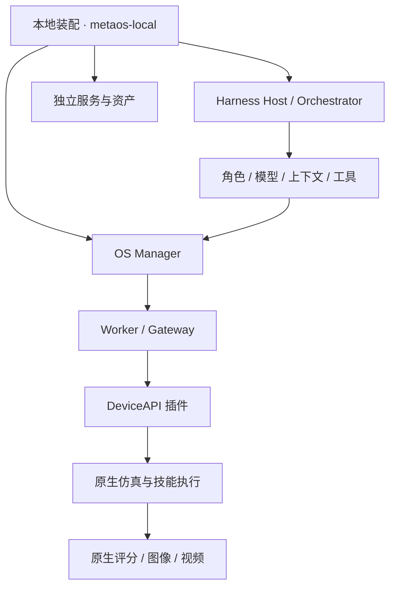

# MetaRoboOS

**面向具身智能的模块化运行与实验框架。**

MetaRoboOS 将设备能力、Agent Harness 和实验运行拆分为可独立开发、显式绑定的组件。你可以接入仿真环境，组合模型、角色、上下文与技能，并用同一套构建和运行流程开展测评与对比实验。

项目提供轻量 OS 运行时、Harness 组件 SDK、本地资源装配工具，以及 LIBERO-PRO 和 RoboCasa 的接入组件。适合需要复用具身 Agent、替换 Harness 部件、记录实验配置和核验原生任务结果的研究与开发工作。

[快速开始](#快速开始) · [架构](#架构) · [仿真与测评](#仿真与测评) · [开发新模块](#开发新模块) · [文档](#文档)

## 核心能力

- **声明式组合**：通过 YAML / JSON 选择组件、配置参数和绑定依赖；构建时检查版本、配置、端口契约与声明的控制语义。
- **可替换的 Harness**：独立组合 Planner、Engineer、Reviewer、模型、上下文、技能、工具、评估器和结果存储，支持围绕这些职责开发替代实现。
- **统一设备访问**：通过设备插件导出能力，由 Manager、Worker 和 Gateway 管理租约、命令有效期、状态校验、取消与结果查询。
- **内容锁与离线部署**：记录组件、已安装包和声明资产的内容身份；支持从本地 wheel 构建 OS 离线部署包，以及生成引用本机环境的运行 Bundle。
- **批量测评**：LIBERO-PRO campaign 支持选择 1–120 条任务、固定种子抽样、逐条隔离执行、断点续跑与分组汇总。
- **可核验的运行记录**：关联模型调用、工具命令、原生评分、图像、视频和清理记录，区分任务失败与基础设施异常。

## 架构

MetaRoboOS 使用三层声明，将业务组合、设备控制和进程装配分别管理：

| 层级 | 职责 | 声明格式 |
| --- | --- | --- |
| Harness | 组合角色、模型、上下文、技能和业务流程 | `metaos.harness-spec/v1` |
| OS | 发现设备插件，导出资源能力，管理控制租约与命令 | `metaos.system/v1` |
| 本地装配 | 绑定 OS、应用、服务和资产，构建并启动工作区 | `metaos.local-harness/v1` |



业务组件可以在同一进程内组合；组件、发行包和进程不要求一一对应。OS 与 Harness 使用独立 Python 环境，设备运行时无需加载 Agent 的重模型依赖。

OS 插件通过 `roborsi.components` 注册，Harness provider 通过 `metaos.harness.components` 注册。两类接口分别维护，新增组件无需修改运行时注册表。

## 快速开始

### 1. 构建并运行 CPU 示例

从仓库根目录执行。随仓库提供的离线依赖面向 **Linux x86_64 / CPython 3.11**；启动环境需具备 `pip`、`setuptools >= 67`、`wheel` 和 `venv`。

```bash
python3.11 -I -B scripts/bootstrap_p0.py --output work/quickstart
```

该命令从源码构建核心包和 Mock 插件，在独立环境中安装，并完成设备动作、取消、租约过期、部署搬迁与离线重建检查。无需 GPU、Docker 或模型服务。输出目录必须是新目录，日志与结果保存在 `work/quickstart/`。

完成后，可用生成的环境查看插件和系统计划：

```bash
work/quickstart/producer/bin/python -I -B -m metaos_runtime plugins
work/quickstart/producer/bin/python -I -B -m metaos_runtime plan \
  --spec configs/p0-system.yaml --root "$PWD"
```

需要独立 Worker、管理器恢复和显式单位转换示例时，运行 CPU 基础设施检查：

```bash
python3.11 -I -B scripts/bootstrap_p1p2.py --output work/managed-example
```

### 2. 装配并运行应用

已有 OS、Harness 环境和资产后，使用本地资源清单组合它们：

```bash
./metaos-local plan /path/to/local.json --resources /path/to/resources
./metaos-local build /path/to/local.json \
  --resources /path/to/resources --output work/my-bundle
./metaos-local verify work/my-bundle
./metaos-local run work/my-bundle --output work/my-run --timeout 14400
```

将 `/path/to/…` 替换为准备好的组合声明和资源池路径。`plan/build` 检查并锁定输入，`run` 启动本次拥有的 OS、应用和服务，并在结束时清理。构建与运行不会隐式下载模型或安装依赖。

本地资源分为 `system`、`application`、`service` 和 `asset`。清单可引用不同目录中的环境、模型和资产，无需复制到同一个目录。完整格式、离线安装与示例见[本地资源装配](docs/local-composition.md)。

> `work/` 保存本机环境、构建和运行产物，不随 Git 仓库分发。首次克隆后需按相应指南准备环境；历史 `evidence/` 索引中的本机路径不能作为新机器的安装路径。

## 仿真与测评

### 已有接入

| 接入 | Harness 与用途 | 使用指南 |
| --- | --- | --- |
| Mock Arm | 无需仿真依赖，体验控制、租约、取消与插件开发 | [OS 接口](docs/p0-api.md)、[常驻运行](docs/p1p2-api.md) |
| LIBERO-PRO · SenseNova-RoboRSI | 单 Agent / ICL，通过独立客户端访问原生仿真 | [API 模型实验](docs/libero-api-experiment.md) |
| LIBERO-PRO · 原 RoboRSI | Planner → Engineer → Reviewer，多轮工具执行与最终判分 | [组件化 Harness](docs/roborsi-modular.md) |
| RoboCasa365 Target50 | 独立设备与 ICL Harness，复用本地装配流程 | [RoboCasa 接入](docs/robocasa-integration.md) |

两条 LIBERO 链路分别维护。原 RoboRSI 技能使用 8 维 `JOINT_POSITION`，另一条设备链路使用 7 维 `OSC_POSE`，应选择对应设备与资产。真实仿真还需准备相应的 GPU、原生环境或容器、模型服务与任务资产，具体要求见接入指南。

LIBERO 已有真实模型闭环、原生判分和媒体核验记录。RoboCasa 提供接入与构建验证，真实任务测评仍待完成。历史验证索引保存在 [evidence/](evidence/)，不以单次实验成绩代表基准性能。

### 组合 RoboRSI Harness

[默认业务图](configs/roborsi-libero.harness.yaml) 包含角色、模型、上下文、技能、工具、环境代理、评估器、结果存储与编排器。修改节点配置或替换同契约 provider，即可定义不同实验组合。

| 实验方向 | 组合方式 |
| --- | --- |
| 模型与角色 | 更换模型端点，或替换 Planner、Engineer、Reviewer 实现 |
| 上下文与经验 | 替换 Context provider，调整经验材料、初始上下文和历史压缩策略 |
| 技能与工具 | 添加技能包，用 `skills.compose` 组合；替换工具集或限制暴露的工具 |
| 执行流程 | 更换 Orchestrator，调整轮次、预算和角色协作方式 |

这些是组件扩展位置；具体消融策略需要由相应 provider 和配置实现。每次变更后重新构建内容锁，保持实验输入明确。准备脚本、技能组合示例和单任务运行方式见 [RoboRSI 接入指南](docs/roborsi-modular.md)。

### 运行选定条数的测评

安装 `metaos-roborsi-campaign`，并按接入指南准备带任务 panel 的 episode Bundle 后，可选择测评规模。下面的 `HARNESS_PY` 为安装了 Harness 和 campaign provider 的解释器，`EPISODE_BUNDLE` 为已构建的 episode Bundle 路径：

```bash
"$HARNESS_PY" -I -B -m metaos_roborsi_campaign.cli build \
  --episode-bundle "$EPISODE_BUNDLE" --count 20 --output work/campaign-20
"$HARNESS_PY" -I -B -m metaos_roborsi_campaign.cli plan \
  --bundle work/campaign-20
"$HARNESS_PY" -I -B -m metaos_roborsi_campaign.cli run \
  --bundle work/campaign-20 --output work/eval-20
```

`--count` 支持 `1..120` 或 `all`；任务须位于准备时锁定的 panel 中。支持分层选取、顺序选取与固定种子随机抽样。中断后可对相同配置和输出目录追加 `--resume`；已获得有效判分的任务不会重复执行，清理未确认时会停止后续调度。

结果保存在 `summary.json` 和逐条 episode 目录中，同时报告有效任务成功率、覆盖率及错误分类。当前协议为单机顺序执行、每任务固定 seed。详细配置见 [campaign 指南](docs/roborsi-campaign.md)。

## 开发新模块

所有 provider 使用 `describe → plan → prepare → open` 生命周期：描述接口、生成计划、准备资源、打开运行实例。构建阶段检查依赖，运行阶段持有资源，关闭阶段释放本次拥有的资源。

| 扩展对象 | 开发入口 | 示例 |
| --- | --- | --- |
| 设备、仿真、控制 Adapter | `metaos-contracts` + `roborsi-sdk`，注册 OS 插件 | [Mock Arm](plugins/mock-arm/)、[角度转换](plugins/joint-degrees/) |
| 模型、角色、上下文、技能和编排 | `metaos-harness`，注册 Harness provider | [RoboRSI 组件](plugins/roborsi-components/) |
| 外部应用、服务和资产 | 编写本地资源清单及显式绑定 | [装配格式](docs/local-composition.md) |

建议按以下流程开发：实现已有契约或定义新契约 → 注册独立发行包 → 安装到隔离环境 → 检查组件发现和计划 → 构建并验证 → 运行针对性实验。设备动作的维度、单位和坐标系需要明确声明，转换通过显式 Adapter 完成。

### 使用开发者 Agent

[AGENTS.md](AGENTS.md) 是开发者 Agent 的项目入口。仓库提供三个 Skill，供 Agent 按任务读取：

- [架构导航](.agents/skills/metaos-architecture/SKILL.md)：定位模块边界、接口和实现。
- [组件开发](.agents/skills/metaos-component-development/SKILL.md)：开发、注册、安装和验证 provider。
- [组装运行](.agents/skills/metaos-harness-assembly/SKILL.md)：选择组件、生成工作区、构建和运行实验。

支持 Skill 的 Agent 可按名称调用；其他 Agent 可直接读取文件。这些开发指南与机器人技能包中的 `SKILL.md / policy.py` 分别维护。

## 项目目录

```text
packages/          核心契约、OS 运行时、Harness SDK
plugins/           设备、Adapter、Harness 与 campaign 组件
configs/           SystemSpec、Harness 图与实验配置示例
assets/            协议等可分发资产
scripts/           环境准备、构建、运行与结果核验工具
tests/             契约、组件、进程生命周期和故障测试
.agents/skills/    开发者 Agent 指南
docs/              接口、接入指南与架构设计
evidence/          历史验证记录与产物索引
modularize-demo/   插件开发示例与离线依赖快照
work/              本机生成的环境、Bundle 与实验结果（Git 忽略）
```

## 文档

| 主题 | 文档 |
| --- | --- |
| 工作区与产物布局 | [目录与工作区](docs/workspace-layout.md) |
| OS 控制与管理接口 | [基础接口](docs/p0-api.md) · [Manager / Worker](docs/p1p2-api.md) |
| 本地安装与装配 | [本地资源装配](docs/local-composition.md) |
| RoboRSI 模块与技能组合 | [组件化 Harness](docs/roborsi-modular.md) |
| LIBERO 批量测评 | [campaign](docs/roborsi-campaign.md) |
| SenseNova-RoboRSI 模型接入 | [API 实验](docs/libero-api-experiment.md) |
| RoboCasa 接入 | [RoboCasa365 Target50](docs/robocasa-integration.md) |
| 长期架构设计 | [MetaOS](MetaOS.md) · [Harness 设计](docs/harness-architecture.md) |

接入指南包含特定机器上的历史示例；使用时请替换环境、资产和服务路径。设计文档中的提案以实际 CLI 与源码实现为准。

## 支持范围与路线图

MetaRoboOS 当前面向单机研究与开发，提供本地 HTTP 访问、协作插件、独立 Worker 和原生进程或容器集成。本地 Bundle 固定本机路径与内容身份；跨机器部署需使用匹配平台的离线部署包，或重新准备环境与资产。

后续重点包括：

- 丰富上下文、经验与技能的可替换组件及对比实验配置。
- 扩展多任务、多 seed 测评与更多仿真、真实设备接入。
- 完善统一安装入口、远程组件目录与依赖解析。
- 引入多节点和 GPU 资源调度、受约束的 Agent Factory。

真实设备接入需独立验证停止与安全机制。进程隔离不等于恶意插件沙箱，进程退出也不等于物理设备停止；当前不提供硬实时或生产设备安全保证。
