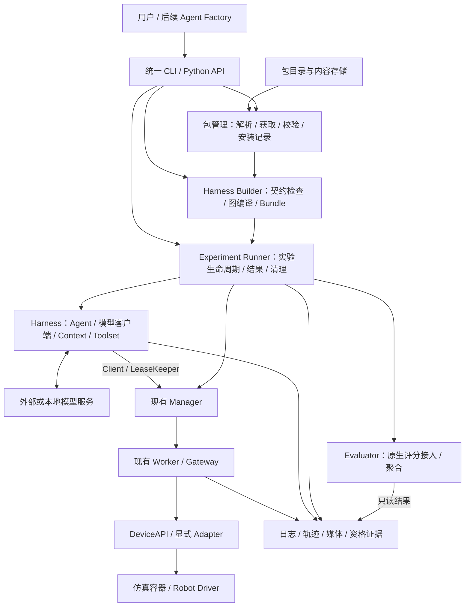

# MetaOS 统一安装、构建与具身实验 Harness 架构

2026-11-06 RoboCasa 增量：已增加独立设备/Harness 插件及本地装配入口，并通过协议与构建检查；真实仿真/模型任务按要求未执行。见 [RoboCasa 接入](robocasa-integration.md)。这不代表下文包管理、Factory 或真实异构环境验收已经完成。

日期：2026-11-04。状态：目标架构设计，尚未实现的 CLI、Schema 与组件名均为提案。

2026-11-06 RoboRSI 增量：已实现该设计的受限子集，包括轻量 `metaos-harness` SDK、`metaos.harness-spec/v1` 图编译、四阶段生命周期、业务端口及运行时 Protocol 校验。`../RoboRSI` 默认由 11 个组件组装，通过新增兼容 Device 使用原技能及 LIBERO JOINT_POSITION 控制；外层复用 `metaos-local`。具体接口以 [RoboRSI 接入](roborsi-modular.md) 为准，单任务完成状态以 [验收证据](../evidence/roborsi-modular-latest.json) 为准。2026-11-07 追加了可选择条数、顺序执行和续跑的 [campaign 子集](roborsi-campaign.md)，尚未运行真实批量测评。远程 Catalog、通用依赖求解和完整跨机器发行仍未实现。

2026-11-05 增量：已实现独立的 [本地资源装配 v1](local-composition.md)，使用 `metaos.local-harness/v1` 和 `./metaos-local`，复用已安装环境与整套 Harness 的启动接口。下文完整 HarnessSpec 和包管理仍属于目标设计；细粒度图编译已在上面的 RoboRSI 子集中实现，不能与整套 Harness 的本地进程装配等同。

2026-11-06 同步：本地装配已完成真实 API 模型 + LIBERO-Pro 单任务评测，原生 success / score=1.0；见 [实验说明](libero-api-experiment.md) 和 [工作区目录](workspace-layout.md)。该结果验证已有组件的本地装配与执行，不扩展下文目标架构的已实现范围。

本设计承接 [MetaOS.md](../MetaOS.md) 的 Package Manager、组件生命周期与 Agent Factory 目标，复用现有 P0/P1/P2 执行底座。它不改变 [P1/P2 交付记录](p1p2-delivery.md) 中真实 27B 单任务仍待验收的结论。

## 1. 用户目标与交付定义

用户安装 MetaOS 后，选择已有组件或发布自己的组件，通过统一命令拼接出可以运行具身实验的 Harness。这里的“构建”是解析、校验、绑定与物化一个明确的组件图；首版不依靠模型临时生成胶水代码。

交付单位是一个 Harness Bundle，包含组件锁、执行计划、OS 配置、依赖闭包、资产身份和启动入口。一个 Bundle 可以供不同任务、seed 和模型参数的多次实验使用。设备、模型和 Agent 保留各自运行环境。

用户主路径如下，所有 `metaos` 命令均为拟新增接口，当前实际入口仍是 `python -m metaos_runtime`：

```bash
# 从已发布模板创建可编辑的声明文件
metaos init libero-27b --output experiments/bowl

# 解析声明、获取组件及依赖，写入并使用精确内容锁
metaos install --spec experiments/bowl/harness.yaml

# 仅使用锁与本地已安装内容构建；默认不访问网络
metaos build --spec experiments/bowl/harness.yaml \
  --lock experiments/bowl/harness.lock.json \
  --output dist/bowl --frozen

# 在当前机器上启动依赖服务，并执行具体实验
metaos run --bundle dist/bowl \
  --experiment experiments/bowl/experiment.yaml \
  --profile profiles/local.yaml
```

安装单个组件也可使用 `metaos install environment/libero-pro@0.1.0`。该操作准备组件及缓存，不自动启动容器、下载未声明的模型或改动已有运行实例。

## 2. 总体架构



安装、构建、运行三个阶段有独立边界：

| 阶段 | 输入 | 输出 | 允许的副作用 |
| --- | --- | --- | --- |
| install | 包名或 HarnessSpec、目录源、平台目标 | 缓存、安装记录、精确 lock、隔离安装环境 | 下载、校验、创建安装环境；不打开设备 |
| build | HarnessSpec、lock、已安装组件 | 不可变 Harness Bundle、兼容性报告 | 读取描述、执行有边界的组件 plan、生成配置与计划；不启动实验 |
| run | Bundle、ExperimentSpec、机器 Profile、凭据引用 | 独立 Run、任务结果与退出证据 | 启动/连接声明的服务，获取租约，执行动作、评分和清理 |

安装记录只有在物化和校验成功后才提交。失败的下载或环境保留为可诊断的临时状态，不登记为已安装。构建输出先写入 staging，再校验后提交为完整 Bundle。

## 3. 六个逻辑模块

逻辑模块不要求拆成六个进程或六个微服务。

### 3.1 Package Catalog 与 Package Manager

- Catalog 描述包名、不可变版本、发布者、契约、依赖、平台、资产和资格证据。
- 获取后端允许 HF 文件、OCI 镜像、本地目录等；上层组件不依赖某个网站。
- 缓存按内容哈希复用；包名版本是查询入口，实际运行使用锁定内容。
- wheel 依赖按运行环境分别求解。OS、Harness、仿真、模型服务不共用一个全局 Python 环境。
- 精确记录 wheel 哈希、资产哈希、HF revision，以及适用的 OCI manifest digest、运行时 Docker image ID。后两者是不同身份，不混为同一个字段。
- 下载产物先校验并物化为普通文件的部署目录，再交给现有安装器；远程下载缓存中的链接和元数据不进入部署文件清单。
- 卸载检查 Bundle 与运行记录引用，不能删除活动服务所依赖的共享内容。升级创建新锁与新安装目录，旧运行仍保留原身份。

### 3.2 Harness Builder

输入是组件声明和绑定关系，输出是可执行的组合计划。Builder 负责：

1. 验证组件配置、契约版本、依赖端口与显式绑定。
2. 检查模型输入模态、工具/动作 Schema、环境观测、任务/评分协议及终止能力。
3. 检查单位、坐标系、关节顺序等业务语义；需要转换时必须绑定明确的 Adapter。
4. 将组合图分成 OS 图、Harness 图和服务启动图；进程间绑定编译为有类型的代理或 endpoint，而不是跨进程共享 Python 对象。
5. 为各运行单元固定软件环境、启动器、就绪检查、权限、超时与清理顺序。
6. 生成现有 SystemSpec、内容锁、依赖闭包与 Bundle。

组件依赖图要求无环；Agent 与环境交替反馈的运行循环由 Runner/Harness 执行，不被误判为构建期依赖环。缺失 Adapter 或契约不兼容时，Builder 输出具体错误与候选需求，不偷偷替换组件。

### 3.3 Harness SDK 与业务组件

复用现有 `roborsi-sdk` 生命周期与可复用业务契约。需新增的业务端口采用独立、轻量的 Harness SDK，现有 `roborsi.evaluation` 类型先通过兼容桥接使用，避免一次性重写原 Agent/CaseRunner，也避免在 OS contracts 中引入评测器依赖。

| 角色 | 提供的接口或内容 | 边界 |
| --- | --- | --- |
| Agent | session 初始化、接收观测、产生动作/工具调用、关闭 | 规划与决策 |
| Model Client | 请求构造、模型调用、响应与用量记录 | 可连接外部服务，也可依赖独立模型服务包 |
| Context | ICL、记忆、提示词与上下文组织 | 内容和策略可分别替换 |
| Toolset | 工具 Schema、调用分派与显式能力映射 | 有副作用的设备调用必须进入 OS 网关 |
| Environment Bridge | reset、step、可选 query/策略结束、finish | 将业务 Episode 映射到 OS 能力 |
| Device / Robot Adapter | describe/read_state/start/stop/close | 由 Worker 持有，负责具体执行 |
| Skill / Perception | 声明输入、输出、资源、超时与副作用 | 可作为工具依赖或独立服务 |
| Evaluator | 消费原生结果并聚合任务指标 | 不自行伪造环境的成功判定 |

端口描述至少包含契约 ID/版本、输入输出 Schema、语义属性和支持的调用方式。设备语义不能只靠 Python 方法同名判断兼容。

例如，`Environment Bridge` 可以统一外层调用形状，但 LIBERO 与 RoboCasa 仍分别声明动作、观测、任务预算、原生评分和策略结束规则。现有 LIBERO GatewayAdapter 的 benchmark 与能力名是固定的，需要新增桥接或提取受测试约束的公共部分。

### 3.4 现有 OS Runtime

继续复用 Manager、Worker、Gateway、Client 和 LeaseKeeper：

- Manager：认证、实例目录、生命周期与路由。
- Worker/Gateway：最终控制权、命令代次、状态校验、执行与停止。
- DeviceAPI：设备或仿真能力实现。

模型推理等待不阻塞独立续租。模型失败、实验取消、租约丢失时，Runner 通过已声明的停止路径处理；不能绕过 Gateway 直接写仿真或硬件。共享外部服务按“借用”记录，Runner 只停止本次拥有的进程与容器。

### 3.5 Experiment Runner

Runner 是新增的实验生命周期管理层，不把现有 `/v1/tasks` 动作命令接口改名冒充 Agent 作业管理。首版提供本机 CLI/API，不要求先增加一个常驻调度服务。

执行顺序：

1. 验证 Bundle 与原始 lock，创建 Run ID，记录本次实验与 Profile。
2. 检查平台、GPU/显存需求、磁盘、端口及外部模型可用性；记录检查结果。
3. 按启动依赖启动或连接系统、环境和模型服务，等待就绪。
4. 绑定资源与权限，通过 Client 获取控制权、reset 环境、启动 Agent session。
5. 运行观测—决策—工具—动作循环，独立续租并记录命令身份。
6. 按原任务协议完成任务，调用原生 finish，交给 Evaluator 记录与聚合。
7. 逆序清理 session、租约及本次拥有的服务；最终落盘清理结果。

区分 `success`、`task_failure`、`agent_error`、`infrastructure_error`、`cancelled` 和 `outcome_unknown`。原协议支持的策略结束可以产生有效评分；运维取消不得伪装成正常评分完成。未知执行结果查询原命令身份，不创建新动作自动重放。

静态显存要求和启动前的可用量检查只能作为准入证据，不等于显存已被隔离或保证。若后端不能提供强制配额，报告该限制；OOM 仍需分类与清理。

### 3.6 Qualification 与 Results

安装、构建、运行就绪、真实模型参与和任务成功分别记录：

- package verified：内容和安装身份正确。
- composition built：组件与绑定在声明范围内兼容。
- runtime qualified：对应平台的启动、控制与故障测试通过。
- model exercised：有本次真实模型响应与动作证据。
- task result：原生结果表明成功或正常任务失败。

通过 smoke 不能晋升成真实任务通过；模型离线记录为阻塞条件。任务正常失败可以证明运行链路完成，但不代表策略有效。

## 4. 声明、锁与机器配置

### 4.1 五种输入/产物的职责

| 名称 | 作用 | 变化时机 |
| --- | --- | --- |
| Package Manifest | 单个发行包的组件、依赖、平台与资产身份 | 发布新版本 |
| HarnessSpec | 选择组件、绑定依赖，描述可复用 Harness | 更换 Agent、环境、上下文或工具 |
| Harness Lock / Bundle | 冻结精确内容，生成系统/业务图和启动计划 | 显式 install/update 与重新 build |
| ExperimentSpec | 任务集、seed、重复次数与预算 | 每次实验可不同 |
| Machine Profile | GPU 选择、目录、外部 endpoint、凭据引用 | 部署到不同机器时 |

现有 SystemSpec 继续作为 OS 图，由 Builder 生成或显式引用，不在其中强行加入 Agent 和 Evaluator。新 HarnessSpec 是其上层。运行时 Profile 只能填写声明的部署参数；更换协议、动作 Schema、组件或资产必须重建。外部模型的声明身份、可观测版本与运行响应元数据进入运行记录；服务只提供可变别名时明确标注复现限制。

当前 OS 内容锁包含实际配置，因此机器参数不能直接写入已锁的 SystemSpec 后继续使用旧锁。Bundle 保存声明式系统模板及允许参数；run 在验证模板身份后填入 GPU、路径等获准参数，在本次 Run 下生成完整 SystemSpec 和对应的 OS lock，再调用现有解析与启动机制。Harness lock 固定软件/协议和参数边界，Run 的 OS lock 固定本次实际部署，两个身份都必须保留。

### 4.2 HarnessSpec 示例

下面是设计示例；包名、版本和新 Schema 均不表示已发布。组件 descriptor 决定端口类型，`placement` 决定对象绑定或 RPC 绑定。

```yaml
schema_version: 1
api: metaos.harness-spec/v1
name: libero-27b

components:
  environment:
    package: environment/libero-pro@0.1.0
    component: environment.libero_device
    placement: system
    config:
      resource_id: environments/libero-pro

  model:
    package: model/remote-chat@0.1.0
    component: model.remote_chat
    placement: harness
    config:
      connection: planner
      model_identity: SenseNova-RoboRSI-27B

  context:
    package: context/libero-icl@0.1.0
    component: context.libero_icl
    placement: harness

  tools:
    package: toolset/libero-native@0.1.0
    component: toolset.libero_native
    placement: harness
    bindings:
      environment: environment

  agent:
    package: agent/roborsi@1.0.0
    component: agent.roborsi
    placement: harness
    bindings:
      model: model
      context: context
      tools: tools

  evaluator:
    package: evaluator/libero-native@0.1.0
    component: evaluator.libero_native
    placement: runner
    bindings:
      environment: environment

entrypoints:
  agent: agent
  environment: environment
  evaluator: evaluator
```

`context/libero-icl` 的版本需在 Manifest 中锁定真实 ICL 清单及内容；ExperimentSpec 的任务选择必须被该 Context 明确覆盖。模型端口也需声明图像输入等实际要求；HTTP API 形状相同不代表模型能力兼容。

```yaml
# experiment.yaml：不改变原评测协议
schema_version: 1
api: metaos.experiment/v1
tasks:
  - id: libero_spatial_task-t00-i00
    seed: 0
repetitions: 1
protocol: native
```

```yaml
# profiles/local.yaml：仅示意部署参数，不包含密钥值
schema_version: 1
api: metaos.profile/v1
devices:
  environment:
    gpu_device: 2
connections:
  planner:
    endpoint_ref: env:MODEL_BASE_URL
    credential_ref: env:OPENAI_API_KEY
workspace: ./runs
```

Profile 中允许覆盖哪些字段由 Bundle 声明。凭据值不进入 lock、Bundle、日志或结果。任务预算和控制语义不能通过 Profile 偷换。

### 4.3 Package Manifest 的最低字段

- `name/version/api`：包与契约版本。
- `components`：组件 ID、配置 Schema、提供的能力、依赖端口与执行方式。
- `dependencies`：组件包依赖与各隔离环境的依赖约束。
- `artifacts`：wheel、镜像、模型、ICL、配置、文件大小和内容身份。
- `platforms/prerequisites`：Python ABI、架构、驱动/运行时和硬件前提。
- `qualification`：适用组合、平台、测试、证据身份与已知限制。

解析器先读取静态发布元数据，物化后检查实际插件 describe 与元数据一致。组件 plan 在声明的环境中运行；不能把加载第三方 Python 代码称为安全沙箱。包内容从受信目录或明确固定的外部指纹验证，下载文件与自带哈希同时被替换不能证明发布者身份。

## 5. 构建产物与实验工作区

```text
dist/bowl/                        # 不可变、可搬迁交付
  harness.yaml
  harness.lock.json
  harness.plan.json               # 组件绑定、运行单元与启动顺序
  bundle.json                    # 全部内容身份、平台和允许的 Profile 字段
  system/                        # 系统模板、参数约束与冻结部分身份
  runtime/                       # OS wheel 闭包
  harness/                       # Agent/Runner wheel 闭包与资产
  images/                        # 离线归档或锁定镜像引用
  reports/build.json

runs/<run-id>/                    # 可变、本次运行专用
  run.json                       # Bundle、实验、Profile 的非敏感身份
  resolved-profile.json           # 不包含凭据值
  system.json                    # 本次机器参数物化后的现有 SystemSpec
  system.lock.json               # 与本次实际配置对应的 OS lock
  preflight.json
  managed/                       # 现有 Manager/Worker 运行目录
  cases/<case-id>/
    agent/                       # 本 case 的 Agent workspace
    result.json
    gateway-commands.jsonl
    trace/
    media/
  result.json
  shutdown.json
```

Bundle 不复制包含绝对路径的现成 venv；保留 wheel 闭包和安装入口，到目标位置重新物化。在线模式可引用本地缓存中的内容；portable/offline 导出必须带齐声明的可分发内容。需联网的外部模型或未交付资产明确列为外部依赖，不能声称全离线。

同一 Bundle 的多个实验使用不同 Run 目录。Agent workspace 只属于该 case，Bundle 只读；敏感凭据通过受限运行上下文传入，密钥环境变量本身不自动变成模型身份的可复现证明。

## 6. 与当前代码的对应关系

| 当前实现 | 本架构中的位置 | 需要的增量 |
| --- | --- | --- |
| SDK entry point 与生命周期 | 组件安装后的发现、计划与打开 | 静态发布元数据，业务端口的统一描述 |
| `metaos-contracts` | OS 数据契约与 DeviceAPI | 保持轻量，不引入 Agent/评测依赖 |
| `composition.resolve/open_system` | Builder 生成的 OS 图执行 | 上层 Harness 图编译与跨进程绑定 |
| `bundle.py/install.py` | 内容锁定、离线交付、冷安装 | 远程来源、缓存、安装事务与 Bundle 协调 |
| Manager / Worker / Gateway | 常驻系统与最终执行权威 | 继续复用，不新增第二套租约权威 |
| 独立 LIBERO Harness / CaseRunner | 第一个业务运行后端 | 标准启动协议、组件化绑定与实验入口 |
| `scripts/bootstrap_*` | 开发与资格验证脚本 | 保留验证用途，常规用户无需运行完整资格矩阵 |

建议首轮只新增一个 `metaos-tooling` 发行包承载 CLI、Catalog、下载与 Builder，再新增 `metaos-experiments` 承载 Runner。轻量 `metaos-harness-sdk` 在出现明确业务端口后独立发行；可以先复用原 SDK/消息桥接，避免为目录整齐提前拆出大量包。设备、模型与策略仍各自独立发行。

## 7. 新插件如何进入工作流

第三方编写 SDK Provider、配置 Schema 与端口契约；构建 wheel/镜像和 Package Manifest，完成对应资格测试后发布到目录。用户 install 后，在 HarnessSpec 增加组件并绑定其端口。Builder 检查兼容性并生成新 Bundle，Runner 按相同生命周期运行。

替换一个模型、Context、工具或环境都通过显式声明产生新锁与新证据。更换为 RoboCasa 时，必须选择 RoboCasa Device、业务 Bridge、工具、Context 与原生 Evaluator 的兼容组合；规划 Agent 可在其所需端口全部满足时复用。模板只是已验证组合的快捷入口，不是每个环境一套专用构建引擎。

后续 Agent Factory 可以输出同一个 HarnessSpec 并调用 install/build/test；生成策略不拥有额外部署权限。第一阶段先把人工声明到可执行 Bundle 的路径做稳定，再让模型自动选择组件。

## 8. 实施顺序与验收

以下是 P1/P2 之后的增量路线，不能代替其仍缺少的真实 27B 验收。

| 步骤 | 实现目标 | 验收标准 |
| --- | --- | --- |
| A：声明与包目录 | Manifest、HarnessSpec、lock、local 获取后端 | 缺依赖、版本冲突、能力/模态/语义不匹配均准确拒绝；不会启动设备 |
| B：统一安装与构建 | 缓存、隔离依赖、图编译、现有 Bundle 协调 | 单次 install/build 可产出 LIBERO Bundle；重复 frozen build 内容身份一致；离线与搬迁可重建；中断安装不登记成功 |
| C：统一实验入口 | Runner、Profile、结果/退出清理协议 | 单条 run 启动完整已声明链路；模型离线正确报告；在线真实单任务有推理、动作、原评分与清理证据 |
| D：组件替换验证 | 可替换模型、Context/Toolset 与环境 | 分别只改声明完成两种兼容模型、两种 Context 的替换；RoboCasa 使用专用桥接和评分接入后，CLI、Builder、Gateway 不写 benchmark 特判 |
| E：远程交付 | HF/OCI 获取后端、版本目录和安装管理 | 新机器从固定版本下载并冷安装；损坏文件拒绝；缓存复用；版本并存；活动依赖不可卸载 |

构建身份一致不要求远程模型输出、视频字节或真实物理轨迹确定一致；分别报告构建复现与实验复现。第二环境不能只证明“容器能起来”，需要证明它经过同一 Builder、Runner 与最终授权链路，并保留其原生语义。

首个交付建议以当前 LIBERO 组件为基础，实现 local 包目录、HarnessSpec、生成 SystemSpec/业务启动计划与统一 run，再加入远程安装。这样可先证明声明式装配确实成立，随后更换分发后端不会改变运行架构。
