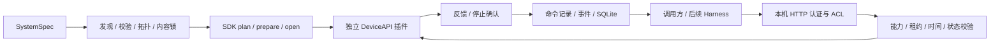

# P0 系统接口与插件接入

本页记录 P0 单进程入口的范围。当前新增的 `manage`、独立 Worker、恢复、原生资产/镜像与 Harness 接入见 [P1/P2 接口与操作](p1p2-api.md)；本页的阶段限制不代表这些新路径缺失。

## 边界与执行路径



OS 运行不要求 benchmark、case、Episode、Agent 或评分器。原 `AssemblySpec` 仍服务评测应用；新的 `SystemSpec` 专门表达通用系统图，两者共享 SDK 生命周期与能力契约，尚未统一为同一个图编译器。

P0 共一个网关服务进程；每个在途动作由工作线程推进，watchdog 检查租约。设备调用在资源锁内协作执行，能力校验和停止确认不能强行中断阻塞驱动。生产化隔离与独立设备 watchdog 属于后续工作。

## SystemSpec

示例见 `configs/p0-monitor.yaml`。字段为 `schema_version: 1`、`api: metaos.system/v1`、`components` 与 `exports`。

- component 节点复用 SDK `ComponentSpec`，增加 `bindings: {依赖端口: 目标别名}`。
- descriptor 声明 provides/requires/dependencies；装配检查版本、配置、端口、能力与 DAG。
- 缺失必需绑定、未知端口、目标不存在、能力不兼容和环均在打开资源前拒绝。
- `plan` 不创建运行 workspace；锁覆盖规范化 spec、拓扑顺序、组件 plan 和选中发行包的源码/元数据身份。
- `serve --lock` 在打开前核对内容；prepare/open 按依赖顺序，close 逆序。
- 只有实现 `DeviceAPI` 的导出节点成为 HTTP 资源；资源 ID 必须唯一。非设备组件可被装配，但不作为设备导出。

配置与 plan 的纯度依赖插件遵守 SDK 契约；当前不隔离第三方插件的副作用。

## DeviceAPI 与能力

公开契约位于 `metaos_contracts`：

| 方法 | 责任 |
| --- | --- |
| `describe_resource()` | 返回资源 ID、能力 JSON Schema、单位、坐标系与状态新鲜度限制 |
| `read_state(clock_id)` | 返回单调序号、时钟域、采样时间、有效性和状态数据 |
| `start(capability, arguments)` | 接受已校验参数，返回 `DeviceOperation` |
| `operation.tick(elapsed_s)` | 非阻塞、协作式推进，返回反馈与 done |
| `stop(reason)` | 请求设备停止，返回是否实际确认停止 |
| `close()` | 释放组件拥有的资源 |

Mock 资源为 `robots/mock-arm`，能力为 `manipulation.move_joint/v1`。参数 `positions` 是两个 `[-3,3]` 弧度值，`duration_s` 范围为 `[0.02,30]`；`units=[rad,rad]`，`frame_id=mock_joint`。网关不会隐式把度转为弧度，也不会转换坐标系。

Mock 配置支持 `resource_id`、`state_age_s`、`failure_step`、`stop_unconfirmed`。后三项仅用于故障注入；不是实际硬件适配参数。monitor 注册为 `tool.mock_arm_monitor`，通过必需 `device` 端口依赖 `manipulation.move_joint/v1`。

## HTTP API

服务只监听 `127.0.0.1`，每次启动生成新 `clock_id`。请求必须有 `Authorization: Bearer <token>`。凭据文件在部署物之外，生成权限为 0600；HTTP 身份来自 token，不能通过 body 声明 owner。`read/control` scope 与资源 ACL 同时生效。

| 方法与路径 | 输入 / 作用 |
| --- | --- |
| `GET /v1/info` | API、网关时钟域与单调时间 |
| `GET /v1/resources` | 只返回有权限的资源及能力描述 |
| `GET /v1/state?resource_id=...` | 资源状态与 gateway_fault |
| `POST /v1/leases/acquire` | `resource_id, ttl_s`，独占控制权，TTL 最大 60 秒 |
| `POST /v1/leases/renew` | 租约引用与 ttl_s，续期且保持 epoch |
| `POST /v1/leases/release` | 租约引用；在途动作确认停止后返回 |
| `POST /v1/commands` | 完整 CommandRequest，返回 accepted/当前记录 |
| `GET /v1/commands/{id}` | 原调用方查询持久化结果 |
| `POST /v1/commands/{id}/cancel` | 空对象 `{}`，原调用方请求取消 |

租约引用为 `resource_id, lease_id, control_epoch`。完整命令另有 `command_id, capability, arguments, clock_id, not_after_ns, state_sequence, frame_id, units`。SDK 客户端 `build_command` 从公开资源描述、状态与网关时间构造该信封；调用方也可显式构造。

网关在首次提交前校验身份/ACL、当前租约与代次、截止时间、能力参数、单位/坐标系、当前状态有效性/新鲜度及序号。命令有效期最大 60 秒；执行过程中再次检查租约与命令截止时间。精确状态序号检查是本版的保守策略，后续连续传感器需要明确的时间/容差策略。

## 状态与故障语义

```text
accepted → executing → succeeded
                   ↘ failed（执行失败且已确认停止）
accepted/executing → cancel_requested → cancelled（已确认停止）
停止未确认 → outcome_unknown + 资源锁定
```

- 收到取消请求不等于设备已停止；只有 stop 明确返回 `stopped=true` 才能记为 cancelled/安全结束的 failed。
- 租约释放、过期、命令过期、SIGINT/SIGTERM 关闭都会停止在途动作；停止完成前不能换主。
- 调用方异常退出不依赖其 finally；网关独立检查租约并要求停止确认。
- stop 未确认则结果 outcome_unknown、资源 gateway_fault=true，后续 acquire/submit 拒绝。P0 无自动清除故障 API。
- 相同 caller、command_id 和请求内容返回已有记录，不重复调用设备；同 ID 不同请求为 command_conflict，其他 caller 不能查/取消该命令。
- 客户端丢失提交响应时抛 `OutcomeUnknown(command_id)`，先查询原 ID。服务端可能未收到、已接受或已完成；不得生成新 ID 盲重试。
- P0 不宣称端到端 exactly-once 物理执行。服务只接受新 workspace；数据库中有重启未知状态的防重放基础逻辑，但未交付管理器崩溃后的恢复与物理状态对账。

错误统一为 `{"error":{"code":"...","message":"..."}}`；常见 code 为 `unauthenticated / forbidden / resource_busy / stale_lease / command_expired / clock_mismatch / semantic_mismatch / stale_state / state_changed / invalid_action / resource_fault`。CLI 错误退出码为 2；不可变部署的 stdlib 安装器校验失败为非零退出。

## 插件与交付流程

新包注册 `roborsi.components` entry point，值指向 provider 工厂。实现四操作，`open` 返回带 cleanup 的 SDK `ComponentHandle`。设备插件只需 contracts 与 SDK；不能依赖 core 的 BaseProvider 或导入 runtime 内部类。

```text
新发行包 wheel
  → 安装到独立环境
  → plugins 发现
  → SystemSpec 声明与 bindings
  → plan 内容锁
  → serve 同一系统 API
  → bundle export 冻结依赖闭包
  → 搬迁 + install.py + verify --installed
  → 正常/故障资格验收
```

`bundle export` 记录文件清单、SHA-256、依赖版本与来源、Python/平台、组件锁身份；凭据不进入部署物。`install.py` 先验证清单、内容、schema 与可选的外部期望指纹，再新建 venv，强制 `--no-index --require-hashes` 安装，并验证已安装字节与重建后的锁。

哈希用于完整性与身份核对，不等同于发布者签名；外部信任来源应提供期望指纹。当前可搬迁的是 **package/config-only** 系统，不支持外部资产、OCI 镜像和跨平台重建；这些不能由原 M5 的能力自动推导为本入口已支持。
