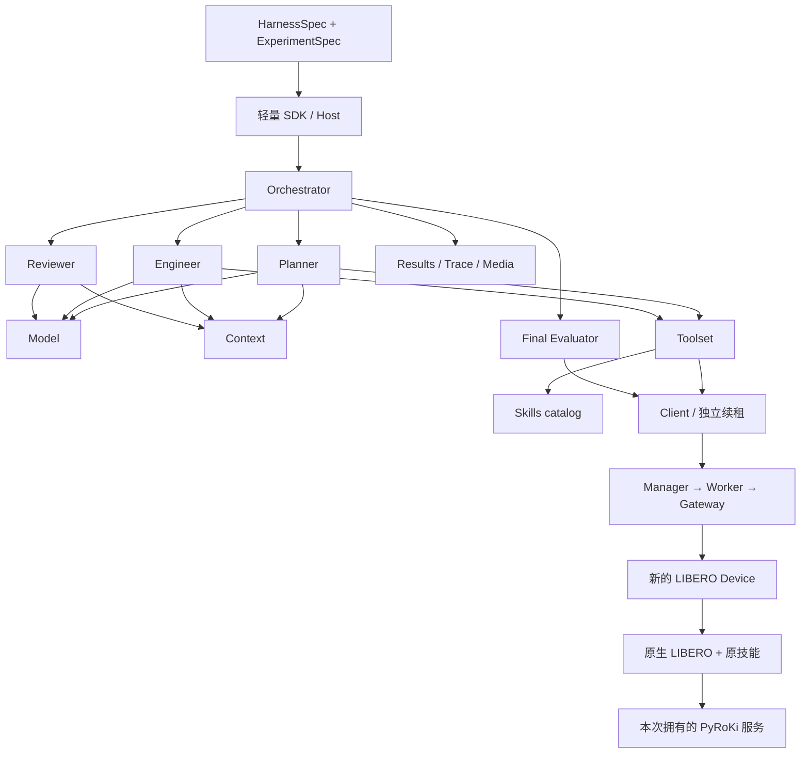

# 原 RoboRSI 的组件化 Harness

本接入针对 `../RoboRSI`，不替代既有 `../SenseNova-RoboRSI` 的单 Agent LIBERO 链路。原始 checkout 固定为 `da3e855adf0b4b9a2824139f4e924d31d3141e5b`，保持不修改。源码快照仅增加显式依赖注入接口和运行产物路径配置；原始技能策略文件不修改。

本文描述 frozen 单任务执行组件。2026-11-07 已新增独立的 [选定条数测评调度模块](roborsi-campaign.md)，可在外层选择 10、20 或全部 120 条任务，并逐条调用本文的组件图；未运行真实批量测评。统计指标复现、跨运行学习和进化写回仍未完成。真实单任务的完成状态以 `evidence/roborsi-modular-latest.json` 为准；没有该证据或 `verified=false` 时，不代表运行验收已完成。

## 组件粒度

逻辑组件通过 `metaos.harness.components` entry point 独立发现和选择，可在同一 Python 进程中组装。组件不等于进程，也不要求一个组件对应一个发行包。

| 组件 | 责任 | 依赖端口 |
| --- | --- | --- |
| `orchestrator.roborsi` | 原 Planner → Engineer → Reviewer 多轮协议、共享预算、最终判分 | 三个角色、tools、environment、evaluator、results |
| `planner.roborsi` | 原 Planner 提示词、任务计划、mission_spec | model、context、tools |
| `engineer.roborsi` | 原 Engineer 和工具循环 | model、context、tools |
| `reviewer.roborsi` | 原公开证据审阅、继续/结束建议 | model、context |
| `model.roborsi` | 原模型调用和角色 session 后端；图像 MIME 适配、请求/响应身份记录 | 配置指定模型端点与 session 模式 |
| `context.roborsi` | 原 wiki、计划读取、初始消息和 trace 压缩 | skills |
| `skills.roborsi_libero` | 原 frozen LIBERO 基础及已发布 compound 技能 | 无；在设备侧原生执行 |
| `skills.compose` | 组合两个技能包；显式同名覆盖 | base、extension |
| `toolset.roborsi_libero` | 同一个工具 catalog/schema、工具分派代理 | skills、environment |
| `environment.libero_roborsi` | OS 网关中的 episode、快照、工具和媒体代理 | 运行时绑定的 OS endpoint 与凭据 |
| `evaluator.libero_roborsi` | 所有轮次后调用原生判定；核验 OS 媒体字节 | environment |
| `results.roborsi` | workspace、文档、trace.db、用量和产物关联 | 每次运行的输出目录 |

默认实例化 11 个组件。`skills.compose` 是可选的第 12 种 provider。基础技能内部仍保留原 RoboRSI 的 `SKILL.md` / `policy.py` 粒度；可以发布包含一个或多个新技能的扩展包再组合，首版没有把每个已有 Python 辅助函数都升级成顶层组件。

OS 设备单独通过原 `roborsi.components` 注册 `environment.roborsi_libero_device`，不改变通用 Manager/Worker 的白名单。PyRoKi 使用独立运行环境和本次拥有的服务进程，保留其原 IK/trajopt 代码。未启用 GraspGen、SAM3 外部服务时，使用原有 fallback；该配置不能声称等于论文中启用这些服务的结果。

## 组合与数据路径



RoboRSI 的成熟技能使用 JOINT_POSITION（7 个关节增量 + gripper，8 维），依赖深度、相机校准、机器人运动学及 MuJoCo 内部对象。因此技能在独立原生进程执行；Python 对象不跨进程传递。角色侧只能看到原适配器过滤后的相机、机器人状态和公开工具结果。所有工具执行经过已有 OS 命令、租约、代次、有效期和状态校验。

原生线程独占 EGL/MuJoCo，保持技能缓存及同一 scene。轮次间不 reset。预算在轮次之间共享。最后一次 Reviewer 完成后才调用最终原生判定；角色看不到该判定。运维停止终止本次拥有的原生进程，不把中断记为有效评分。未知命令结果查询原 command_id，不自动重放动作。

最终判分生成评分、视频和产物清单后，原生服务正常退出并关闭仿真环境；Device 等待该进程退出才完成判分命令。等待使用独立的进程清理锁，不占用状态读取锁，保持 Worker 健康查询和租约续期可响应。此时设备状态标为无效，不能再接收动作，但已冻结的产物仍通过 OS ArtifactAPI 读取。这样耗时的 GPU/仿真清理在最终命令的时限内完成，不挤占 Worker 的短退出窗口。独立验收同时检查原生 exit=0、未强杀、Worker 句柄关闭和租约为零。

预算沿用原实现的口径：`tool_budget` 限制单轮模型工具回合数，一条模型回复可包含多个工具调用；后续轮次按前轮 trace 消耗扣减剩余预算。因此它不是严格的网关命令数量上限，结果中的 `tool_calls` 和网关命令数量另行记录，不能把配置值当作实测调用数。

## 安装与构建

核心路径：

- `packages/metaos-harness/`：轻量契约、四阶段生命周期、端口/版本/语义检查、拓扑、Host 和内容锁。
- `plugins/roborsi-components/`：上述业务组件及私有原生执行器。
- `plugins/roborsi-libero-device/`：独立 OS Device，OS Python 不导入 MuJoCo、Torch 或新的 RoboRSI。
- `scripts/snapshot_roborsi.py`：干净基线检查、源码快照、精确注入补丁、原始/适配后文件哈希。
- `scripts/bootstrap_roborsi.py`：从明确的本地依赖模板离线安装两个环境和非 editable wheel；复制前发现原 Conda 缓存并检查核心包是否齐全，避免复制数 GB 后才发现解释器缺失。
- `scripts/prepare_roborsi.py`：模型权重物化、内层图编译、外层本地资源声明。
- `scripts/verify_roborsi_run.py`：单任务证据核验。

从新目录安装。依赖模板是已经安装好 LIBERO 的 Python 3.12 环境；明确指定它，不会修改该模板：

```bash
python scripts/bootstrap_roborsi.py \
  --source ../RoboRSI \
  --base-env /data3/xzx/conda-envs/roborsi-py312 \
  --os-base-python work/p1p2-final-03/producer/bin/python \
  --os-wheelhouse work/p1p2-final-03/wheels \
  --output work/roborsi-new
```

新 Harness 环境不使用旧的 `roborsi-sdk` / `metaos-contracts`；OS 使用原轻量 Python 3.11。原 checkout 的 editable `roborsi` 和无关的硬件/TUI path injection 会从复制后的环境移除，再安装快照 wheel。这里提供的是**本机内容锁定的依赖环境与重建流程**；它依赖显式的本地模板和现有资产，不是可直接搬到任意机器的完整 OCI/离线发行包。

选择组件见 `configs/roborsi-libero.harness.yaml`。任务与预算见 `configs/roborsi-libero.experiment.yaml`。默认使用原 RoboRSI 支持的 `role_sessions: stateless` API 路径，模型为 `openai/deepseek-ai/DeepSeek-V4.1-Flash`；这是显式配置，不等同于原项目默认的 persistent CLI session。要复现 persistent 配置，改成 `persistent`，准备原 CLI 后端及其凭据，再重新构建。

四个生命周期接口：`describe` 描述接口；`plan` 校验配置和绑定；`prepare` 核验原计划；`open` 用实际依赖创建对象。单独 `plan/build` 不启动模型、仿真或设备。

```bash
HP=work/roborsi-new/harness-env/bin/python
OP=work/roborsi-new/os-env/bin/python

"$HP" -I -B -m metaos_harness.cli components
"$HP" -I -B -m metaos_harness.cli plan --spec configs/roborsi-libero.harness.yaml

python scripts/prepare_roborsi.py \
  --harness-python "$HP" --os-python "$OP" \
  --libero-root /data3/xzx/roborsi-repro/LIBERO-PRO \
  --bddl /data3/xzx/roborsi-repro/LIBERO-PRO-assets/bddl_files \
  --init /data3/xzx/roborsi-repro/LIBERO-PRO-assets/init_files \
  --pyroki-python /data3/xzx/roborsi-repro/venv-pyroki/bin/python \
  --pyroki-port 15559 --gpu 5 \
  --output work/roborsi-new/assembly --run-root work/roborsi-new/runs

./metaos-local build work/roborsi-new/assembly/local.json \
  --resources work/roborsi-new/assembly/resources \
  --output work/roborsi-new/bundle
./metaos-local verify work/roborsi-new/bundle
```

`prepare` 只物化现有的 Grounding-DINO / SAM / OWLv2 本地 cache，记录具体 revision 和字节身份，不在 run 中隐式下载。可用 `--hf-cache`、`--robot-cache` 指定缓存。外层 Bundle 锁定内层图、两个运行环境、PyRoKi 环境及源代码、Panda 几何、LIBERO/BDDL/init 资产与感知权重。修改组件、模型、schema 或资产后必须重建。运行数据目录不属于不可变输入。

首次扫描大型 ML 环境时，外层校验会读取数 GB 文件及大量头文件；单个 Python 环境的字节扫描上限为 1200 秒。本次提供的 PyRoKi 依赖模板是 CPU 版 JAX；GPU 参数用于仿真/感知及进程可见设备，并不把 CPU 版 JAX 自动升级成 GPU 求解器。

## 单任务运行与核验

选择空闲 GPU 和未占用的专用 PyRoKi 端口。预先在环境中设置 `OPENAI_API_KEY`，不把密钥写入声明、命令行参数或 Bundle。

```bash
./metaos-local run work/roborsi-new/bundle \
  --output work/roborsi-new/runs/task00 --timeout 14400

python scripts/verify_roborsi_run.py \
  --run work/roborsi-new/runs/task00 \
  --output work/roborsi-new/single-task-evidence.json
```

核验脚本需要本机 `ffprobe` 与 `ffmpeg`，会实际解码最终视频；评分失败不会使链路验收失败，但缺少真实评分、视频损坏、命令身份不符或清理未确认都会导致 `verified=false`。

关键输出：`run.json` 的应用状态及清理记录；`results/result.json` 的真实任务结果；`results/native/score.json` 的原生判分；原生视频/帧；`model-events.jsonl` 的真实响应身份；`gateway-commands.jsonl` 与 Worker SQLite 中相互对应的命令；原始 `plan.md / summary.md / review.md / trace.db`。

应用 exit 0 只表示执行完毕。必须结合 native score 判断 success / task_failure。单任务失败可以证明链路运行完成，不能证明策略成功率。API 模型别名可能变动，因此记录的源代码、请求配置、响应身份和用量仍不足以冻结外部模型权重。

2026-11-06 已完成的本机运行位于 `work/roborsi-modular/runs/task03/`，使用 `assembly-retirement-fix/` 与 `bundle-retirement-fix/`。任务 `libero_goal_task/0`、seed 0：三角色均实际执行，334 个物理步、29 次工具调用，一次 reset 和一次最终判分；原生 `task_failure / score=0.0 / outcome=budget_exceeded`。独立验收 26 项全部通过，包含视频真实解码、网关命令摘要、产物字节、原生 exit=0 且未强杀、Worker 句柄关闭及租约归零，见 [最终证据](../evidence/roborsi-modular-latest.json)。另有 16 项定向检查通过，没有进行 campaign 或多 seed 测试。

模型边界会按图像实际字节修正 data URL 的 MIME 标签：原 `observe_orbit` 返回 PNG，但原消息帮助函数统一标成 JPEG，严格端点会报 400。适配层只修正标签，保留原图像内容，并有定向检查。该问题的首次中断记录保留在 `work/roborsi-modular/runs/task00/`；它没有完成最终评分，不能作为有效任务结果。

## 新增与组合模块

新发行包注册自己的 entry point，例如：

```toml
[project.entry-points."metaos.harness.components"]
"model.my_provider" = "my_package:provider"
```

`provider()` 返回 SDK 的 `Provider(Descriptor(...), factory)`。Descriptor 声明唯一 ID、版本、提供的契约、各依赖端口、配置 JSON Schema、语义约束及需要锁定的实现发行包。factory 接收配置、显式 bindings 和运行时输出信息；返回实现相应 Protocol 的对象。需要清理的对象实现 `close()`。

例如替换模型时，实现 `ModelAPI.call / role / review`；把新组件安装到 Harness 环境，修改 model 节点的 component/config，保持角色对 model 节点的绑定，再重新 prepare/build。替换 Planner 时实现 `PlannerAPI.plan`，直接修改 planner 节点，Orchestrator 不需要改代码。

新增技能包实现 `SkillsAPI.specs / catalog / dispatch_native`。`specs` 是提供给模型和原生端共同核验的工具 schema，`dispatch_native` 在设备原生线程内调用。将它与原技能包组合：

```yaml
  original_skills:
    component: skills.roborsi_libero
  extra_skills:
    component: skills.my_libero_extension
  skills:
    component: skills.compose
    bindings: {base: original_skills, extension: extra_skills}
    config: {overrides: []}
```

让 Context 和 Toolset 的 skills 端口继续指向组合节点。新包必须同时安装在 Harness/原生共享的 Python 3.12 环境；prepare 会提取该 skills 依赖子图，让原生端用同一组件和版本打开。缺少端口、配置或版本不匹配、图中有环、OS/Joint 控制语义不符、未声明的同名技能覆盖，都会在构建或 catalog 校验时拒绝。

首版组合器保留原技能内部的控制、感知和运动规划组织。若要把某项感知或规划器继续拆成独立服务，应先定义其输入/输出、坐标系、资源、超时和副作用契约，再对相应原生技能增加显式注入；不能只换一个 endpoint 就宣称语义兼容。
